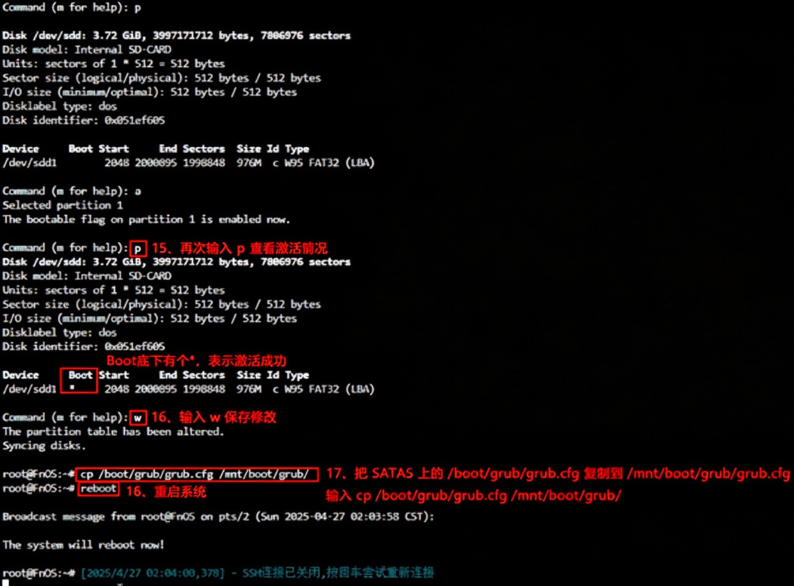

<!-- 官方徽标 -->
<p align="Left">
  <a href="https://github.com/MarkBindy/Software_router" target="_blank">
    
  </a>
  &nbsp;
  <a href="" target="_blank">
    
  </a>
  &nbsp;
  <a href="" target="_blank">
    
  </a>
  &nbsp;
  <a href="https://github.com/Eilte/Mobaxterm-Chinese/releases" target="_blank">
    
  </a>
  &nbsp;
  <a href="https://openwrt.org/start" target="_blank">
    
  </a>
  <a href="http://myip.ipip.net/" target="_blank">
    
  </a>
</p>

---
# 磁盘扩容（仅适用官方原版 **[OpenWrt](https://openwrt.org/start)** 25以上系统）
>确认是 SquashFS 固件，利用系统自带 loop0 回环设备实现无损在线扩容！(不需要格式化、创建 sda3 ，只需分区表在底层被拉满)
手动强制它检测并修复 GPT 尾部指针，然后执行扩容，请严格输入以下指令：

第一步：登入后台终端（更换成自己路由器 IP 地址）
```
ssh root@192.168.3.1
```
第二步：安装 parted / losetup / resize2fs 模块
```
apk update
apk add parted
apk add losetup
apk add resize2fs
```
第三步：进入 parted 交互模式并修复 GPT 尾部指针
```
parted /dev/sda
```
第四步：请在 (parted) 后面依次输入下方命令并回车（在 parted 交互界面中修复并扩容）
```
print
```
第五步：💡关键点：输入 print 后，parted 会强制扫描整块磁盘，这时它绝对会弹出提示：Warning: Not all of the space available to /dev/sda appears to be used... Fix/Ignore? 看到这个提示后，请立刻在 Fix/Ignore? 后方输入命令并回车
```
Fix
```
第六步：将第二分区在底层完美扩容至物理磁盘大小的100%
```
resizepart 2 100%
```
第七步：退出
```
quit
```
第八步：重启路由器（让 Linux 内核认清刚刚变大的物理分区边界）
```
reboot
```
第九步：重启后无损一键刷新底层空间

>等待路由器重启完成，重新 SSH 登入后台终端。由于 SquashFS 固件读写层挂载在虚拟回环设备 /dev/loop0 上，直接对其在线刷新

>让系统将 loop0 虚拟设备强行扩展到刚才变大的整个物理 sda2 空间
```
losetup -c /dev/loop0
```
第十步：在线把 ext4 文件系统撑满整个虚拟空间
```
resize2fs /dev/loop0
```
第十一步：输入命令检查，可用配置空间已扩容至物理磁盘的100%
```
df -h
```

# 示例展示说明：
```
root@OpenWrt:~# parted /dev/sda
GNU Parted 3.6
Using /dev/sda
Welcome to GNU Parted! Type 'help' to view a list of commands.

(parted) print

Warning: Not all of the space available to /dev/sda appears to be used, you can fix the GPT to use all of the space (an extra 61253695 blocks)
or continue with the current setting?

Fix/Ignore? fix

Model: ATA KR 32G (scsi)
Disk /dev/sda: 31.5GB
Sector size (logical/physical): 512B/512B
Partition Table: gpt
Disk Flags:

Number  Start   End     Size    File system  Name  Flags
128     17.4kB  262kB   245kB                      bios_grub
 1      262kB   17.0MB  16.8MB  fat16              legacy_boot
 2      17.0MB  126MB   109MB

(parted) resizepart 2 100%
(parted) quit

Information: You may need to update /etc/fstab.

root@OpenWrt:~# reboot
root@OpenWrt:~# Connection to 192.168.3.1 closed by remote host.
Connection to 192.168.3.1 closed.

C:\Users\z>ssh root@192.168.3.1
root@192.168.3.1's password:


BusyBox v1.37.0 (2026-06-30 07:11:43 UTC) built-in shell (ash)

  _______                     ________        __
 |       |.-----.-----.-----.|  |  |  |.----.|  |_
 |   -   ||  _  |  -__|     ||  |  |  ||   _||   _|
 |_______||   __|_____|__|__||________||__|  |____|
          |__| W I R E L E S S   F R E E D O M
 -----------------------------------------------------
 OpenWrt 25.12.5, r33051-f5dae5ece4 Dave's Guitar
 -----------------------------------------------------

 OpenWrt recently switched to the "apk" package manager!

 OPKG Command           APK Equivalent      Description
 ------------------------------------------------------------------
 opkg install <pkg>     apk add <pkg>       Install a package
 opkg remove <pkg>      apk del <pkg>       Remove a package
 opkg upgrade           apk upgrade         Upgrade all packages
 opkg files <pkg>       apk info -L <pkg>   List package contents
 opkg list-installed    apk info            List installed packages
 opkg update            apk update          Update package lists
 opkg search <pkg>      apk search <pkg>    Search for packages
 ------------------------------------------------------------------

For more information visit:
https://openwrt.org/docs/guide-user/additional-software/opkg-to-apk-cheatsheet

root@OpenWrt:~# losetup -c /dev/loop0

root@OpenWrt:~# resize2fs /dev/loop0

resize2fs 1.47.3 (8-Jul-2025)
Filesystem at /dev/loop0 is mounted on /overlay; on-line resizing required
old_desc_blocks = 1, new_desc_blocks = 235
The filesystem on /dev/loop0 is now 30727260 (1k) blocks long.

root@OpenWrt:~# df -h
Filesystem                Size      Used Available Use% Mounted on
/dev/root                 6.0M      6.0M         0 100% /rom
tmpfs                     7.8G    372.0K      7.8G   0% /tmp
/dev/loop0               27.6G     81.9M     26.3G   0% /overlay
overlayfs:/overlay       27.6G     81.9M     26.3G   0% /
/dev/sda1                16.0M      6.2M      9.8M  39% /boot
/dev/sda1                16.0M      6.2M      9.8M  39% /boot
tmpfs                   512.0K         0    512.0K   0% /dev
```
# 后台终端修改 IP 地址
登入后台终端，输入
```
vi /etc/config/network
```
键盘上按 ：i 进入编辑模式
移动光标至 IP 地址行，修改 IP（随意）,修改完成后按 ESC 键退出编辑模式，再次输入（保存）
```
:wq
```
重启网络服务
```
service network restart
```
重启路由器
```
reboot
```
# 安装 CPU / GPU 温度显示监控
图形化界面
```
apk update
apk add collectd-mod-thermal
```
```
apk update
apk add luci-app-statistics
apk add luci-i18n-statistics-zh-cn
```
首页显示
```
apk update
wget --no-check-certificate -O /tmp/luci-app-temp-status-0.8.1-r1.apk https://github.com/gSpotx2f/packages-openwrt/raw/master/25.12/luci-app-temp-status-0.8.1-r1.apk
```
```
apk --allow-untrusted add /tmp/luci-app-temp-status-0.8.1-r1.apk
```
```
rm /tmp/luci-app-temp-status-0.8.1-r1.apk
```
```
service rpcd restart
```
#  Reset 重置恢复初始默认配置
重置

```
firstboot
```
确认

```
y
```
重启

```
reboot
```
# 更换国内镜像源（针对国内网络下载慢/挂掉）
```
sed -i 's/downloads.openwrt.org/mirrors.cloud.tencent.com\/openwrt/g' /etc/apk/repositories
```
# 安装上传包内文件
```
apk add --allow-untrusted /tmp/upload.apk
```

# SSH工具切换root用户并开启自动引导
第一步：登入后台终端（更换成自己飞牛NAS IP 地址）
```
ssh 账号@192.168.3.1
```
第二步：账号切换成 root 用户
再次输入密码，提示: root@FnOS 表示root用户切换成功
```
sudo su -
```
第三步：输入 lsblk ,根据提示上的容量大小,查看 SD 卡 / U 盘的盘符
```
lsblk
```
第四步：卸载 SD 卡 / U 盘,路径需要按具体情况填写
```
umount /vol00/Internal_SD-CARD
```
第五步：创建磁盘分区表,输入 y 确认
```
parted /dev/sdd mklabel msdos
```
第六步：创建磁盘分区
```
parted /dev/sdd mkpart primary fat32 1M 1024M
```
第七步：格式化分区
```
mkfs.fat -F32 /dev/sdd1
```
第八步：挂载 SD 卡 / U 盘到mnt下
```
mount /dev/sdd1 /mnt/
```
第九步：安装对应架构的 GRUB 软件包
HP MicroServer Gen8 默认使用传统的 Legacy BIOS (MBR) 引导方式，请先运行以下命令安装 PC 架构的 GRUB 组件（以 Debian / Ubuntu / PVE 系统为例）：
(注：如果你在 BIOS 中开启了 UEFI 引导，则需要安装 grub-efi-amd64-bin)
```
apt update
apt install grub-pc-bin
```
第十步：写入引导：等待安装完成后，回到命令行提示符，执行安装命令：
(注：如果之前报错或提示找不到目录，也可以改用 --boot-directory=/mnt/boot)
```
grub-install --target=i386-pc --root-directory=/mnt /dev/sda
```
验证成功：如果终端返回 Installation finished. No error reported
说明 GRUB 引导已经成功写入到 /dev/sda 中了
第十一步：将刚创建好的grub分区激活，否则还是无法自动引导
```

